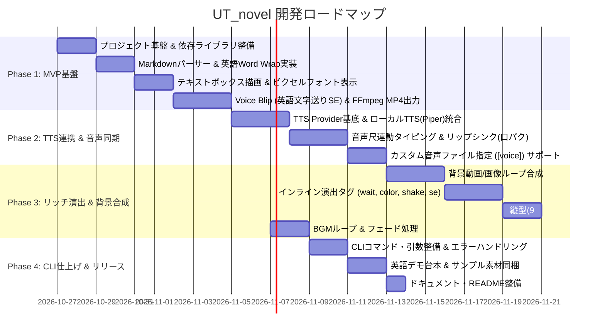

# 03. 開発ロードマップ & タスク一覧 (Roadmap & Tasks)

## 1. 開発フェーズ全体像

音声ファースト（Audio-driven）アーキテクチャと英語ベース（Word Wrapping & TTS同期）の導入を踏まえ、ロードマップを更新しました。

---

## 2. フェーズ別詳細タスク

### Phase 1: MVP（英語Voice Blipによる最小動作確認）
**ゴール**: 英語のMarkdown台本から、単語改行付きでUndertale風テキストボックスが描画され、英語特有のピコピコ音（スペース無音、句読点ポーズ）を伴ってタイピングされるMP4動画を生成できること。

- [x] **プロジェクト初期化**
  - `requirements.txt` 作成 (`pillow`, `pydub`, `python-frontmatter`, `numpy` 等)
  - 基本ディレクトリ構成の作成
  - 英語ピクセルフォント（PixelOperator等）の配置
  - キャラクター用Voice Blip音（beep音/ボイス音）の配置
- [x] **レンダラー最小実装**
  - PillowによるUndertale風ダイアログ枠の描画
  - タイピングアニメーション描画（1文字/2フレームなど）
- [x] **音声合成 & エンコード**
  - アルファベット表示時のみSEを鳴らし、スペースで無音、句読点でポーズを挟むVoice Blip音声トラック生成
  - FFmpegパイプによるMP4動画書き出し
- [x] **パーサー & 英語 Word Wrapping 実装**
  - セリフ行のパース (`* speaker(face): text`)
  - ダイアログボックス幅に応じた単語単位の自動改行（Word Wrapping）

---

### Phase 2: TTS連携 & 音声同期リップシンク 【完了】
**ゴール**: 英語TTS（Piper等のローカル音声エンジンやカスタム音声ファイル）と連携し、セリフ音声の長さに合わせてタイピングと口パクが自動同期する仕組みを完成させる。

- [x] **TTS Provider 抽象基底クラスの作成**
  - 音声生成インターフェース (`BaseTTSProvider`)
  - 音声合成プロバイダー（`GTTSProvider`）の実装
  - ユーザー指定の既存音声ファイルを使用する `CustomAudioProvider` 実装
- [x] **音声主導（Audio-driven）タイムライン同期**
  - 生成された音声の長さ（デュレーション）から、文字送り速度を自動計算
  - 音声再生とタイピング進行の精密同期
- [x] **顔グラフィック表示 & 口パク（リップシンク）**
  - ダイアログ左側にキャラクター表情画像を表示
  - 音声再生中（タイピング中）の口パクスプライト切り替え／上下揺れ（Bobbing）アニメーション

---

### Phase 3: 背景動画合成 & リッチ演出 & 縦型/横型対応
**ゴール**: 背景動画との合成、演出タグ、マルチアスペクト比対応を行い、YouTube Shorts / 通常動画の両方で使える完成度に引き上げる。

- [x] **背景動画/画像ループ合成**
  - 背景動画（MP4）を読み込み、ループさせながらダイアログと合成
- [x] **インライン演出タグ**
  - `[wait: 秒数]` : 指定時間の一時停止
  - `[shake]` : 揺れる文字（ランダムオフセット描画）
  - `[color: 色]` : 文字色の変更
  - `[se: 音声]` : 任意タイミングでの効果音再生
- [x] **マルチアスペクト比対応**
  - `16:9` (1920x1080) 横型レイアウト
  - `9:16` (1080x1920) 縦型レイアウト（スマホ・Shorts向け）
- [x] **BGMミキシング**
  - BGMループ再生、フェードアウト、音量バランス調整

---

### Phase 4: CLI仕上げ & 最適化 【完了】
**ゴール**: 誰でも手軽に英語対話動画を生成・量産できる使い勝手の良いツールにする。

- [x] **CLIコマンド整備**
  - `ut-novel render --script input.md --output out.mp4`
  - `--aspect-ratio`, `--fps`, `--preview-sec` などの引数サポート
- [x] **英語デモスクリプト & サンプル同梱**
  - すぐに試せるサンプル台本（Voice Blip版、TTS版、Shorts版、リッチ演出版）
  - デフォルトキャラクター素材（Toriel、Sans）
- [x] **ドキュメント・README整備**
  - インストール手順、台本の書き方ガイド、CLIオプション説明
