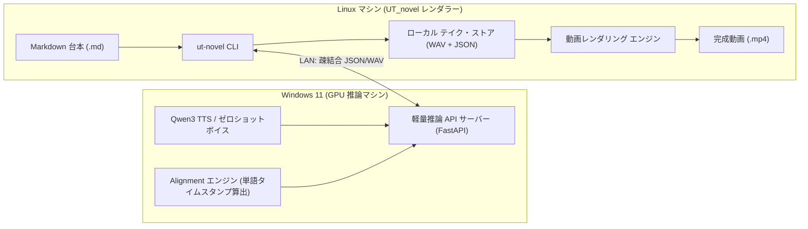
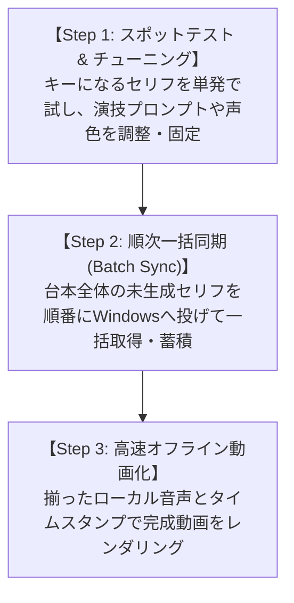

# 05. 外部TTS（Qwen3 TTS等）連携構想 & 設計ブレスト (External TTS Brainstorming)

## 1. 全体像と前提構成 (Architecture & Setup)

本構想は、ローカルネットワーク（LAN）内の **Windows 11 GPUマシン（音声推論担当）** と、**Linuxマシン（UT_novel 動画生成エンジン担当）** を **疎結合（Decoupled）なAPI契約** で接続し、**反復的な微調整（リテイク）** と **単語タイムスタンプ（Word Timestamps）による映画クオリティのアニメーション同期** を実現するための開発計画です。



---

## 2. 疎結合インターフェース契約 (API Contract)

Linux（UT_novel）と Windows 11（GPUマシン）の間でやり取りするデータ仕様です。特定モデルに依存しない汎用的なインターフェースとします。

### リクエスト (Linux → Windows)
```json
{
  "text": "Welcome to the ancient ruins, explorer.",
  "speaker": "dev_girl_1",
  "style_prompt": "warm, gentle, calm voice, soft breathing, slow pace",
  "reference_audio": "dev_girl_ref.wav",
  "need_alignment": true
}
```

### レスポンス (Windows → Linux)
```json
{
  "status": "success",
  "duration": 4.82,
  "audio_base64": "<WAVバイナリのBase64文字列>",
  "words": [
    {"word": "Welcome", "start": 0.08, "end": 0.62},
    {"word": "to",      "start": 0.65, "end": 0.78},
    {"word": "the",     "start": 0.81, "end": 0.92},
    {"word": "RUINS,",  "start": 0.98, "end": 1.65},
    /* 1.65s 〜 2.40s（0.75秒間）の感情的な「間・息継ぎ」を自動検出 */
    {"word": "my",      "start": 2.40, "end": 2.65},
    {"word": "child.",  "start": 2.70, "end": 3.25}
  ]
}
```

---

## 3. Word Timestamps が生み出す表現力の革新

| 演出項目 | 現行方式 (文字数均等配分) | Word Timestamps 導入後 |
| :--- | :--- | :--- |
| **タイピング速度** | セリフ全体で常に一定の速度 | 早口部分は速く、強調単語はゆっくりと発音に完全連動 |
| **息継ぎ・間（沈黙）** | 音声が無音でも文字だけが淡々と流れ続ける | 声が止まっている間、**タイピングもピタッと一時停止** |
| **リップシンク (口パク)** | 音声尺の間ずっと一定リズムで上下微動 | 「実際に声が出ている単語区間」のみ口パク・Bobbing |

---

## 4. 反復微調整を支える 3ステップ・制作ワークフロー

AI音声はテイクごとのニュアンスの揺らぎが大きいため、「一発勝負」ではなく「納得いくまでセリフ単位で試行し、最後に一括同期する」運用を基本とします。



### Step 1: スポットテスト（単発リテイク）
台本全体を動かさず、重要なセリフだけを単発でWindowsマシンにリクエストして試聴・微調整します。
```bash
# 2行目のDev Boyの台詞だけ、感情プロンプトを変えて別テイクを生成
ut-novel voice test --line 2 --prompt "calm, deep chuckle, energetic"

# その1行だけの音声＋タイピングを3秒のプレビュー動画で即時確認
ut-novel preview --line 2
```
納得がいったら、そのテイクを「確定（Lock）」します。

### Step 2: 順次一括同期（Batch Sync）
声質やプロンプトのトーンが固まったら、台本全体の音声を順次取得します。
```bash
# 台本全体を走査し、未生成のセリフだけを順番にWindowsマシンへリクエスト
ut-novel voice sync --script script.md
```
- **レジューム機能**: 途中でネットワークが途切れても、再実行時は未生成のセリフから自動再開。
- **差分スキップ**: Step 1 で既に確定したセリフや生成済みのセリフはスキップ（GPU時間を無駄に消費しない）。

### Step 3: 高速オフライン動画化（Render）
すべての音声ファイル（`.wav`）と単語タイムスタンプ（`.json`）がローカルに揃っているため、動画出力はネットワーク通信ゼロで数秒で完了します。
```bash
ut-novel render --script script.md -o output/final_movie.mp4
```

---

## 5. ローカル テイク・ストア構造案 (Take Store)

台本ファイル（例: `ruins.md`）と同じ階層に、セリフごとのテイク履歴を安全に保持します。

```text
scenarios/ruins_encounter/
├── script.md
└── takes/
    ├── line_001_girl/
    │   ├── take_1.wav (+ take_1.json)   # テイク1
    │   ├── take_2.wav (+ take_2.json)   # テイク2 (採用！★)
    │   └── selected.wav -> take_2.wav   # 確定テイク
    └── line_002_boy/
        ├── take_1.wav (+ take_1.json)
        ├── take_2.wav (+ take_2.json)
        └── selected.wav -> take_2.wav
```

---

## 6. Windows 11 (GPU側) の実装スタック案

Windows 11 側で動作させる最小限の構成です。

- **実行基盤**: WSL2 または Windows ネイティブ Python (Conda環境)
- **API フレームワーク**: FastAPI + Uvicorn
  - エンドポイント: `POST /api/v1/synthesize`
- **音声生成モデル**: Qwen3 TTS (Zero-shot Voice Cloning)
- **アライメント**: Whisper / WhisperX / CTC Forced Alignment
  - 音声生成直後に内部パイプラインで自動実行し、Word Timestamps を付与してレスポンス。

---

## 7. まとめ

この設計により：
1. **最高峰の表現力**: Qwen3 TTS の豊かな演技力 ＋ 発音と100%連動したタイピング演出。
2. **クリエイターの自由度**: 納得のいくまでセリフ単位でリテイク・固定が可能。
3. **システムの堅牢性**: Windows/Linux間の疎結合化により、障害に強く、メンテナンスやモデル差し替えが容易。

今後の開発着手時には、本設計書をベースに実装仕様を策定できます。
