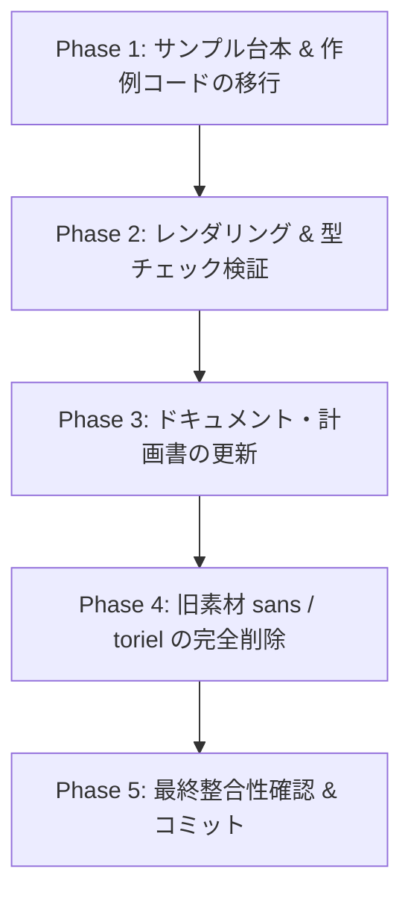

# 06. 著作権準拠キャラクター素材移行計画 (Character Migration Plan)

## 1. 背景と目的 (Background & Objectives)

本プロジェクト（`UT_novel`）は、Undertale風のピクセルアートダイアログと動画合成を行う汎用CLIツールです。
初期開発（Phase 1〜4）において動作検証用サンプルとして同梱されていた `sans` および `toriel` の顔グラフィック画像やセリフ表記は、原作ゲーム（Undertale）の著作権・知的財産権に関わる素材です。

プロダクトを完全なオープンソース／クリーンな配布物として公開・運用できるよう、**すべての著作権侵害リスクのある素材・名称・セリフを完全排除**し、あらかじめ用意されたオリジナル1-bitピクセルキャラクター（`dev_boy_1`, `dev_girl_1`）に統一・移行します。

---

## 2. 移行先キャラクター仕様 (Target Character Specifications)

すでに `assets/char/` 配下に配備済みのオリジナルキャラクター素材を標準公式キャラクターとして定義します。

| キャラクターID | 表示名 | 特徴 | 表情 | 推奨音声モード・Voice |
| :--- | :--- | :--- | :--- | :--- |
| **`dev_boy_1`** | `Dev Boy` (または `Alex` 等) | メガネ・短髪の少年 | `smile.jpg` (819x819) | **blip**: `assets/se/voice_low.wav` **tts**: 男性英語音声 (`en_US` 等) |
| **`dev_girl_1`** | `Dev Girl` (または `Emma` 等) | メガネ・ツインテールの少女 | `smile.jpg` (1400x1400) | **blip**: `assets/se/voice_high.wav` **tts**: 女性英語音声 (`uk` / `us` 等) |

---

## 3. 影響範囲の全量棚卸し (Impact Scope & Inventory)

### A. 削除対象素材 (Assets to Remove)
- `assets/char/sans/`（`grin.jpg` を含むディレクトリ全体）
- `assets/char/toriel/`（`smile.jpg` を含むディレクトリ全体）

### B. サンプル台本・作例 (`examples/`)
Undertaleの固有名詞（Toriel, Sans, RUINS, butterscotch pie, bone punなど）を含む台本・コードをオリジナルセリフへ刷新。
1. **`examples/dialogue_ruins.md`**:
   - `toriel`, `sans` → `dev_girl_1`, `dev_boy_1` に変更
   - 遺跡探索をテーマにしたオリジナル会話に刷新
2. **`examples/dialogue_tts.md`**:
   - キャラクター定義を `dev_girl_1`（TTS: uk）、`dev_boy_1`（TTS: us）に変更
   - 会話文を更新
3. **`examples/shorts_encounter.md`**:
   - 縦型Shortsデモ台本のキャラクターとセリフを更新
4. **`examples/dialogue_m5_rich.md`**:
   - リッチ演出タグデモ台本のキャラクターとセリフを更新
5. **`examples/test_composites.py`**:
   - `sans_face`, `toriel_face` の画像読み込みパスとテキストを更新

### C. ドキュメント・計画書 (`README.md`, `memo/PLAN/`)
1. **`README.md`**:
   - Frontmatter記載例（`characters:`）、サンプルセリフの更新
   - ディレクトリ構成図の注記更新（`Toriel, Sans` → `dev_boy_1, dev_girl_1`）
2. **`memo/PLAN/01_concept_and_spec.md`**:
   - サンプル台本記載例の更新
3. **`memo/PLAN/02_architecture.md` / `03_roadmap.md`**:
   - デフォルト素材の記述更新
4. **`memo/PLAN/05_external_tts_brainstorming.md`**:
   - 例示ディレクトリ名・スピーカー名の更新
5. **`memo/PLAN/README.md`**:
   - 本計画書のインデックス追加

### D. アセット生成スクリプト (`assets/generate_se.py`)
- コメント表記のクリーン化（`(Sans-like)` → `(Low pitch)`、`(Papyrus/Toriel)` → `(High pitch)`）

※ `src/ut_novel/` コアエンジン内には特定キャラクター名へのハードコード依存はなく、データ駆動設計となっているため、エンジン本体のロジック変更は不要です。

---

## 4. 台本・セリフ刷新ポリシー (Script Renewal Policy)

- 原作ゲームのセリフ引用やパロディを完全に排除。
- レトロRPG／探索ノベル／プログラミング・テック会話などの親しみやすいオリジナル会話に変更。
- ピクセルアート・インライン演出タグ（`[wait]`, `[shake]`, `[color]`, `[se]`）の動作確認機能は100%維持。

---

## 5. 段階的移行ステップ (Execution Phases)

### Phase 1: サンプル台本 & 作例コードの移行
1. `examples/dialogue_ruins.md`、`dialogue_tts.md`、`shorts_encounter.md`、`dialogue_m5_rich.md` を `dev_boy_1`, `dev_girl_1` 構成に更新。
2. `examples/test_composites.py` の画像パスと出力ファイル名を更新。
3. `assets/generate_se.py` のコメントを中立化。

### Phase 2: レンダリング & 型チェック検証
1. `python3 examples/test_composites.py` の実行確認。
2. 更新後の各サンプル台本のMP4レンダリングテスト（プレビュー実行）。
3. `npx pyright src examples` で型エラーゼロを確認。

### Phase 3: ドキュメント・計画書の更新
1. `README.md` のFrontmatter記法・セリフ例・ディレクトリ図を更新。
2. `memo/PLAN/01_concept_and_spec.md` などの計画書内のサンプル記述を統一。
3. `memo/PLAN/README.md` に本計画を追加。

### Phase 4: 旧素材（`sans`, `toriel`）の完全削除
1. `assets/char/sans/` を削除。
2. `assets/char/toriel/` を削除。
3. リポジトリ内全体を grep 検索し、意図しない残存参照がないか最終スキャン。

### Phase 5: 最終整合性確認
1. 全体テスト実行・動画生成確認。
2. `git status` / `git diff` による変更範囲の最終確認。

---

## 6. 完了基準 (Definition of Done)

- [x] リポジトリ全体で `assets/char/sans`, `assets/char/toriel` へのパス参照が完全に 0 件であること。
- [x] `assets/char/sans`, `assets/char/toriel` ディレクトリが完全に削除されていること。
- [x] 全ての `examples/*.md` が `dev_boy_1` / `dev_girl_1` を使用し、正常にMP4レンダリングできること。
- [x] `npx pyright src examples` がエラー 0 件であること。
- [x] `README.md` および `memo/PLAN/` 内の記述がクリーンに更新されていること。
